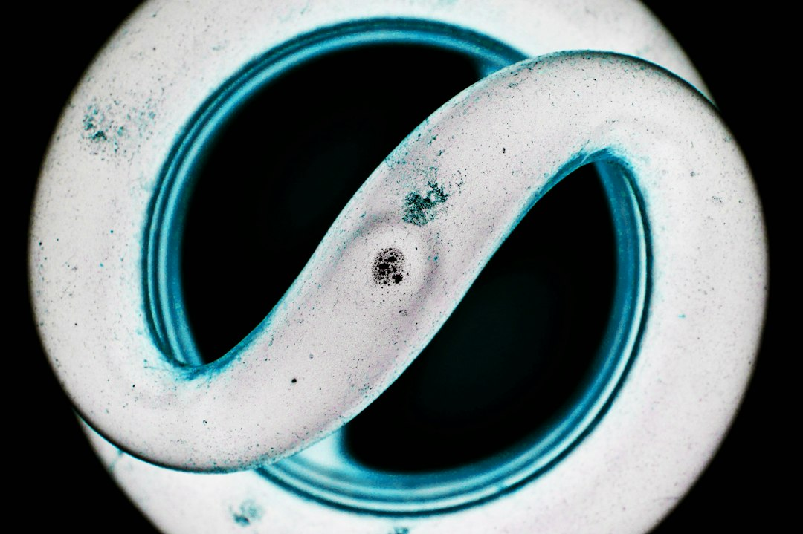
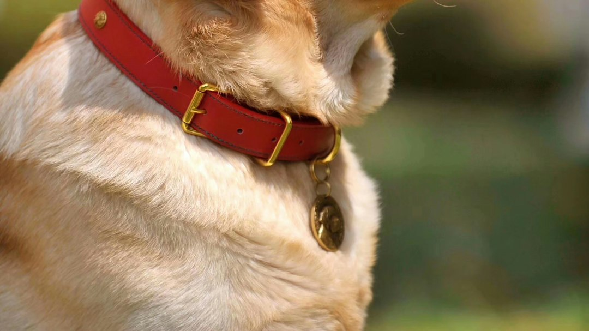

# 驱虫不是可有可无的小事：猫狗驱虫全攻略，一篇讲透

很多铲屎官都有这样的困惑："我家猫从来不出门，还需要驱虫吗？""驱虫药多久喂一次才合适？"今天我们就来聊聊猫狗驱虫这件事。

**为什么驱虫必不可少**

寄生虫分两大类：体内寄生虫和体外寄生虫。体内常见的有蛔虫、钩虫、绦虫和心丝虫；体外主要是跳蚤、蜱虫和螨虫。

这些"小坏蛋"的危害远超想象：蛔虫和钩虫会抢夺营养，导致宠物消瘦、腹泻、被毛粗糙，幼龄动物大量寄生时甚至可能危及生命；绦虫会让宠物肛门瘙痒、出现"蹭屁股"行为；蜱虫能传播巴贝斯虫等多种血液寄生虫病；心丝虫的成虫寄生于心脏和肺动脉，一旦感染治疗难度极大，预防远比治疗重要。

更值得警惕的是，蛔虫、钩虫等部分寄生虫是人宠共患的。家中有老人、孩子或免疫力较低人群的家庭，定期给宠物驱虫不仅保护毛孩子，也是在保护家人。

<figure style="margin: 1.5em 0; text-align: center;">
  
  <figcaption style="margin-top: 0.5em; color: #666; font-size: 0.9em;">
    显微镜下的蛔虫卵，是猫狗最常见的体内寄生虫之一
  <small>图片来源: [Scott Rodgerson](https://unsplash.com/@scottrodgerson) @ Unsplash</small>
  </figcaption>
</figure>

**宠物感染寄生虫的常见信号**

- 食欲很好却日渐消瘦；
- 呕吐或腹泻，粪便中偶见虫体；
- 频繁抓挠、啃咬皮肤，局部掉毛；
- 肛门周围"蹭屁股"；
- 牙龈苍白（提示贫血）。

需要注意的是，很多感染初期没有明显症状，等出现上述表现时，寄生虫可能已经"安家落户"很久了。所以驱虫讲究"防大于治"。

<figure style="margin: 1.5em 0; text-align: center;">
  
  <figcaption style="margin-top: 0.5em; color: #666; font-size: 0.9em;">
    跳蚤繁殖极快，宠物身上可见的成虫只是冰山一角
  <small>图片来源: [Charlotte Harrison](https://unsplash.com/@charlottelharrison) @ Unsplash</small>
  </figcaption>
</figure>

**驱虫频率：不同阶段有讲究**

- **幼犬幼猫（6月龄以下）**：体内、体外驱虫均建议每月1次。幼龄动物免疫力弱，且容易通过母乳感染蛔虫，是驱虫的关键期。
- **成年猫狗（6月龄以上）**：体内驱虫每1～3个月1次，体外驱虫建议每月1次。具体频率可结合生活环境、饮食习惯（是否吃生食、是否爱舔舐地面）与兽医商议确定。
- **心丝虫预防**：蚊虫是心丝虫的传播媒介，在蚊虫活跃季节（南方地区几乎全年），建议每月使用含心丝虫预防成分的驱虫药。

<figure style="margin: 1.5em 0; text-align: center;">
  
  <figcaption style="margin-top: 0.5em; color: #666; font-size: 0.9em;">
    幼犬第一次驱虫通常由兽医指导完成，之后可在家定期操作
  <small>图片来源: [Jonatan Bustos](https://unsplash.com/@jonatanbustos25) @ Unsplash</small>
  </figcaption>
</figure>

**选药有门道，安全第一条**

市面上的驱虫药大致分为三类：体内驱虫药（片剂、口服液）、体外驱虫药（滴剂、喷剂）和内外同驱产品。三个安全要点务必记牢：

1. **猫狗驱虫药不通用。**含有氯菊酯/拟除虫菊酯类的犬用驱虫产品对猫毒性极强，可能引发抽搐甚至死亡，切勿混用。
2. **按体重选择剂量。**用药前先称重，严格按说明书的体重区间给药。过量的风险远大于"多用一点更保险"。
3. **认准正规渠道和兽药批号。**避免网购来路不明的"三无"产品。

<figure style="margin: 1.5em 0; text-align: center;">
  
  <figcaption style="margin-top: 0.5em; color: #666; font-size: 0.9em;">
    驱虫滴剂需滴在宠物颈后舔不到的位置
  <small>图片来源: [Lepeto](https://unsplash.com/@lepeto) @ Unsplash</small>
  </figcaption>
</figure>

**破除三个常见误区**

误区一："宠物不出门就不用驱虫。"错。人的鞋底、裤脚可能把虫卵带回家，家中蚊虫、老鼠也是传播源。不出门的宠物同样需要驱虫，只是频率可以适当降低。

误区二："看不到虫子就等于没有寄生虫。"多数体内寄生虫肉眼不可见；跳蚤方面，宠物身上可见的成虫只占环境中跳蚤总量的很小一部分，大量虫卵和幼虫藏在地毯、窝垫里。看不到不等于不存在。

误区三："驱虫一次管终身。"驱虫药的作用周期有限，且只对用药时体内存在的寄生虫有效，规律用药才能形成持续保护。

**给主人的实用清单**

1. 建立驱虫日历：在手机日历中设置提醒，体内、体外驱虫分别记录，避免遗漏。
2. 新宠到家先隔离、先驱虫，尤其家中已有其他宠物时。
3. 驱虫后留意宠物反应，如出现呕吐、精神萎靡等情况，及时联系兽医。
4. 每年带宠物做一次粪便检查，让驱虫方案更有的放矢。
5. 保持环境清洁：定期清洗窝垫、吸尘、清理猫砂盆，减少环境中虫卵的存量。

驱虫是养宠日常中"看不见却很重要"的一环。规律驱虫，毛孩子的健康和我们自己的安心，都能多一重保障。