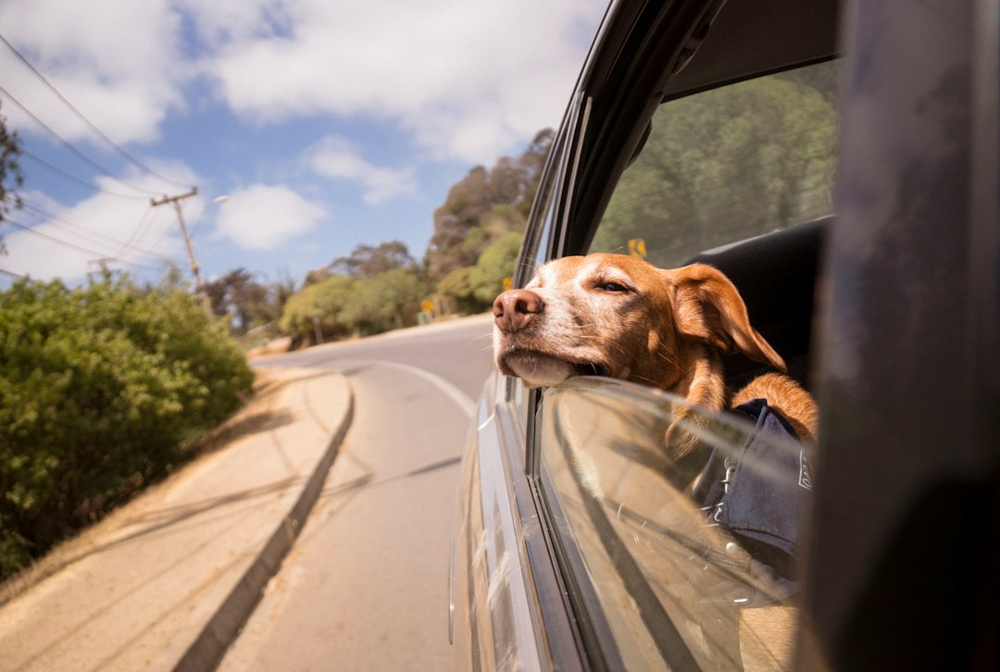

# 高温警报！宠物中暑死亡率近五成，这份防暑指南能救命

进入盛夏，各地接连发布高温预警。人可以吹空调、喝冷饮，但全身"穿着毛大衣"的猫狗，散热能力远不如我们。今天这篇，请每位铲屎官认真看完——因为它可能关系到一条命。

## 一、为什么毛孩子更容易中暑？

人和狗的散热方式完全不同。人靠全身出汗蒸发降温，而狗狗的汗腺几乎只分布在脚掌，主要靠张嘴喘气散热；猫咪则靠舔毛和寻找阴凉处调节体温。一旦环境温度高、湿度大，这种散热效率就会直线下降。

狗狗体温突破41℃即进入危险区，超过42.5℃时，肝肾等多器官可能在数小时内衰竭。兽医临床数据显示，犬中暑的死亡率可高达50%左右——中暑，真的不是"歇一歇就好"的小问题。

<figure style="margin: 1.5em 0; text-align: center;">
  
  <figcaption style="margin-top: 0.5em; color: #666; font-size: 0.9em;">
    狗狗主要通过喘气散热，高温高湿天气下散热效率大幅下降
  <small>图片来源: [Surya Teja](https://unsplash.com/@suryadoingstuff) @ Unsplash</small>
  </figcaption>
</figure>

## 二、4个致命误区，很多人还在犯

**误区1：车窗留条缝，把宠物放车里没事。**
真相：盛夏阳光下，密闭车内温度10分钟就能飙升到50℃以上，留条缝几乎没有降温作用。每年夏季，都有宠物因被留在车内而丧生。

**误区2：中午遛狗，让狗"出出汗排排毒"。**
真相：正午地面温度可达60℃，狗狗的肉垫会被直接烫伤；而且狗的散热效率远低于人，同样跑一圈，人只是出点汗，狗可能已经中暑。

**误区3：短毛狗不怕热。**
真相：散热能力与毛长关系不大。法斗、巴哥等短鼻犬呼吸道短，喘气散热效率更低，恰恰是最高危的群体。

**误区4：发现中暑先喂冰水"降降温"。**
真相：冰水会使血管骤然收缩，反而阻碍散热，还可能刺激肠胃。正确做法是用常温水。

<figure style="margin: 1.5em 0; text-align: center;">
  
  <figcaption style="margin-top: 0.5em; color: #666; font-size: 0.9em;">
    密闭车内在阳光下10分钟即可升温至50℃以上，切勿将宠物单独留在车内
  <small>图片来源: [Ignacio Amenábar](https://unsplash.com/@amenabarladrondeguevara) @ Unsplash</small>
  </figcaption>
</figure>

## 三、中暑的信号，请牢记

早期：喘气急促、大量流涎、牙龈发红、心跳加快、精神萎靡、走路打晃。
严重：呕吐腹泻、牙龈发紫、抽搐、倒地昏迷。

一旦发现上述信号，请立刻行动，不要等待观察。

## 四、急救三步，抓住黄金时间

**第一步**：马上把宠物移到阴凉通风处，解开项圈和胸背。
**第二步**：用常温水（不是冰水）浸湿毛巾，擦拭它的腹股沟、腋下和脚掌，同时用风扇吹风加速散热。
**第三步**：边降温边送往最近的宠物医院，途中保持通风。

记住：即使症状暂时缓解，也建议做一次检查——热射病造成的内脏损伤，可能几小时后才显现。

<figure style="margin: 1.5em 0; text-align: center;">
  
  <figcaption style="margin-top: 0.5em; color: #666; font-size: 0.9em;">
    用常温水浸湿毛巾擦拭脚掌和腹股沟，为中暑宠物物理降温
  <small>图片来源: [Martin Wemyss](https://unsplash.com/@mw41) @ Unsplash</small>
  </figcaption>
</figure>

## 五、日常防暑清单，照着做就行

- **调整遛狗时间**：改到清晨或晚上，出门前用手背贴一下地面，感觉烫手就取消。
- **保证充足饮水**：家里多放几个水碗，外出随身带水；可丢一两块冰块，既降温又好玩。
- **室内主动降温**：开空调或风扇，空调设在26℃左右即可，避免直吹；给宠物留出能自行选择的凉爽区域。
- **善用降温装备**：凉垫、铝制降温板、保持通风的笼具都是好帮手。
- **高危群体重点看护**：短鼻犬、老年犬、肥胖宠物、长毛猫，以及患有心脏病的宠物耐热能力差，气温25℃以上就要开始留心。

最后送大家一句口诀：**"三不三要"**——不把宠物单独留车内、不在高温时段遛狗、不用冰水猛浇全身；要多喝水、多观察、多通风。

防暑无小事，转给身边每一位养宠人，愿所有毛孩子都能安然度夏。