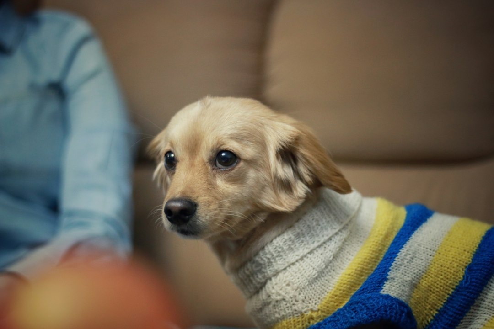
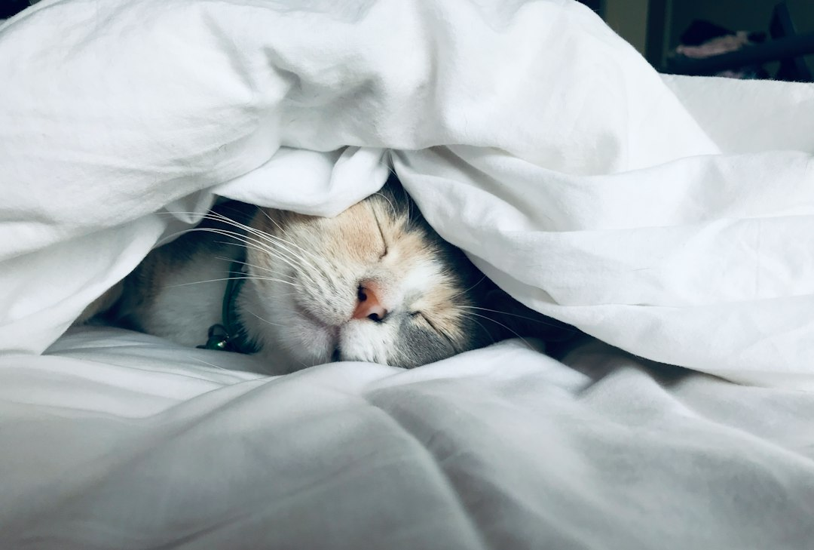
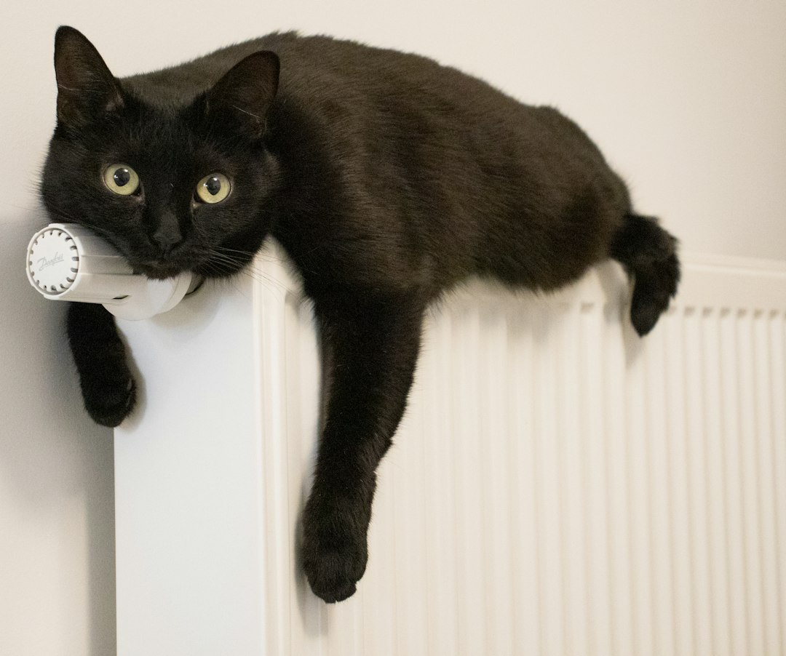
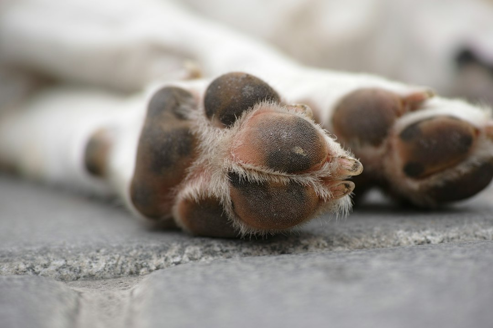

# 别让"保暖"变"伤身"：冬季宠物护理的五个关键点

立冬过后，气温骤降，很多主人开始给毛孩子添衣加被。但你知道吗？冬季保暖并不是"多穿多盖"这么简单，做错了反而可能害了它们。今天我们就来聊聊，如何科学地帮宠物过冬。

## 一、谁更需要"重点关照"

并不是所有宠物都同样怕冷。一般来说，短毛犬猫、小型犬、幼年和老年宠物、以及患有心脏病、关节炎的个体，对寒冷更敏感。像吉娃娃、迷你杜宾、斯芬克斯无毛猫等，体表面积相对大、皮下脂肪少，散热快，室温低于15℃时就可能出现不适；而哈士奇、阿拉斯加等双层被毛品种则有天然优势。如果家里有老年犬猫，寒冷潮湿的环境会加重关节疼痛，它们起身、爬楼时会明显变慢，需要特别注意。

<figure style="margin: 1.5em 0; text-align: center;">
  
  <figcaption style="margin-top: 0.5em; color: #666; font-size: 0.9em;">
    短毛小型犬在室内也需要穿保暖衣物
  <small>图片来源: [Avin Ezzati](https://unsplash.com/@avinezzati) @ Unsplash</small>
  </figcaption>
</figure>

## 二、学会判断：它是不是真的冷

宠物不会说话，但身体会"告诉"你。当猫狗感到寒冷时，常见表现包括：身体蜷缩成一团、尾巴紧贴身体、耳朵和爪垫摸上去发凉、间歇性发抖、主动寻找暖气片或钻被窝。狗狗正常体温约38—39℃，猫咪约38—39.2℃，如果摸起来耳尖冰凉且精神变差，说明保温已经跟不上散热的节奏，需要尽快回暖。

<figure style="margin: 1.5em 0; text-align: center;">
  
  <figcaption style="margin-top: 0.5em; color: #666; font-size: 0.9em;">
    猫咪蜷缩在毯子里保暖是怕冷的典型表现
  <small>图片来源: [Kate Stone Matheson](https://unsplash.com/@dreadpiratekato) @ Unsplash</small>
  </figcaption>
</figure>

## 三、保暖的正确打开方式

首先解决"睡"的问题。宠物窝最好离开地面10厘米以上，垫厚一些，远离门口、窗边等冷风直吹的位置。老年犬猫可以在垫子下加一块宠物专用加热垫（注意必须有恒温控制和防咬线保护），或者简单地在窝旁挂一个装有热水的瓶子、用毛巾包裹，也能起到温和加温的作用。

穿衣方面要记住一个原则：室内如果温度适宜，不必强行穿衣；外出散步时，短毛小型犬可以穿合身的保暖衣，**回家后及时脱下**，并检查衣物是否潮湿、皮肤是否起静电或打结。衣服过紧会摩擦皮肤，反而诱发皮肤问题。

## 四、取暖设备：最大的隐形风险

每年冬天，都有宠物因取暖设备受伤的案例。电热毯调得过高可能造成"低温烫伤"；猫咪好奇去碰电暖器，胡须和毛发被烤焦的情况并不少见；还有宠物啃咬电线导致触电。建议所有取暖设备加装防护罩，人不在家时务必关闭电热毯和电暖器，改用保温窝垫。

<figure style="margin: 1.5em 0; text-align: center;">
  
  <figcaption style="margin-top: 0.5em; color: #666; font-size: 0.9em;">
    宠物靠近电暖器有烫伤风险，应加防护罩
  <small>图片来源: [Andrey Volk](https://unsplash.com/@a_al_volk) @ Unsplash</small>
  </figcaption>
</figure>

## 五、冬天还有这些细节别忽略

**饮水和排尿**：天气冷，猫狗的饮水量普遍下降，而饮水不足正是冬季泌尿系统问题高发的原因之一，尤其是猫咪。可以把水换成温水，或添置宠物饮水机增加流动水吸引力。

**爪子和皮肤**：北方路面常撒除冰剂，回家后用温水冲洗爪垫并擦干；爪垫干燥开裂可以涂抹宠物专用护爪膏。冬天洗澡频率应适当降低，洗后务必彻底吹干，否则湿冷很容易让它们感冒。

**饮食**：户外活动量大的狗狗，冬天可以适当增加10%左右的喂食量补充能量；但整天待在家、运动量骤减的宠物，反而要防止吃出"冬膘"导致肥胖。

<figure style="margin: 1.5em 0; text-align: center;">
  
  <figcaption style="margin-top: 0.5em; color: #666; font-size: 0.9em;">
    冬季外出后应检查并清洁狗狗的爪垫
  <small>图片来源: [engin akyurt](https://unsplash.com/@enginakyurt) @ Unsplash</small>
  </figcaption>
</figure>

## 给主人的冬季自检清单

最后，送你一份可以贴在冰箱上的自检清单：

- 每天观察宠物是否发抖、蜷缩、长时间赖在暖气旁；
- 窝垫离地、厚实、远离风口，外出衣物回家即脱；
- 电热毯、电暖器加防护，人离屋即断电；
- 保证温水供应，观察排尿是否正常；
- 出现持续发抖、精神萎靡、呼吸急促、食欲骤降，别在家硬扛，及时就医。

<figure style="margin: 1.5em 0; text-align: center;">
  
  <figcaption style="margin-top: 0.5em; color: #666; font-size: 0.9em;">
    兽医为宠物做冬季健康检查
  <small>图片来源: [aref sarkhosh](https://unsplash.com/@arefsarkhosh) @ Unsplash</small>
  </figcaption>
</figure>

冬季的温暖，从来不是"越多越好"，而是"恰到好处"。读懂毛孩子的身体语言，做好这几个细节，这个冬天它们就能又暖又安全地度过。