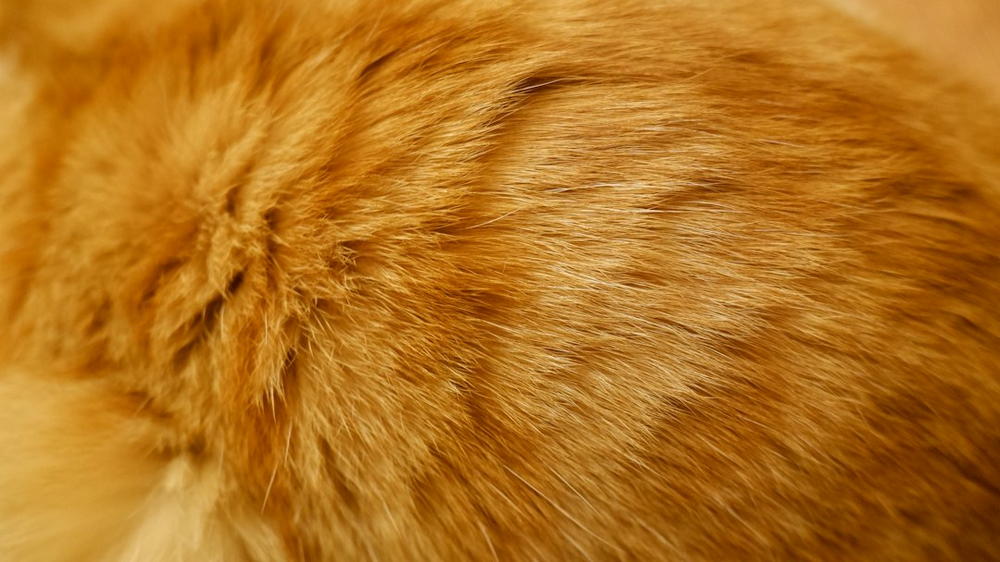
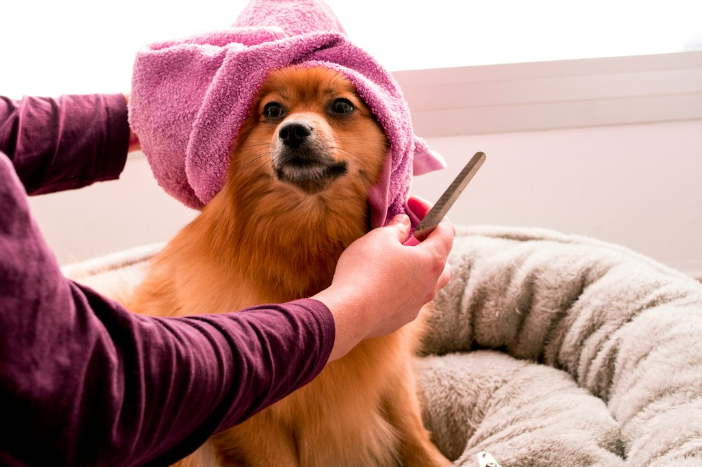
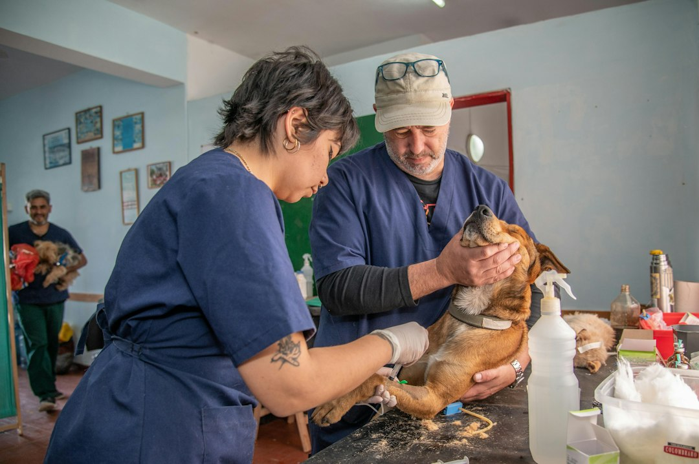
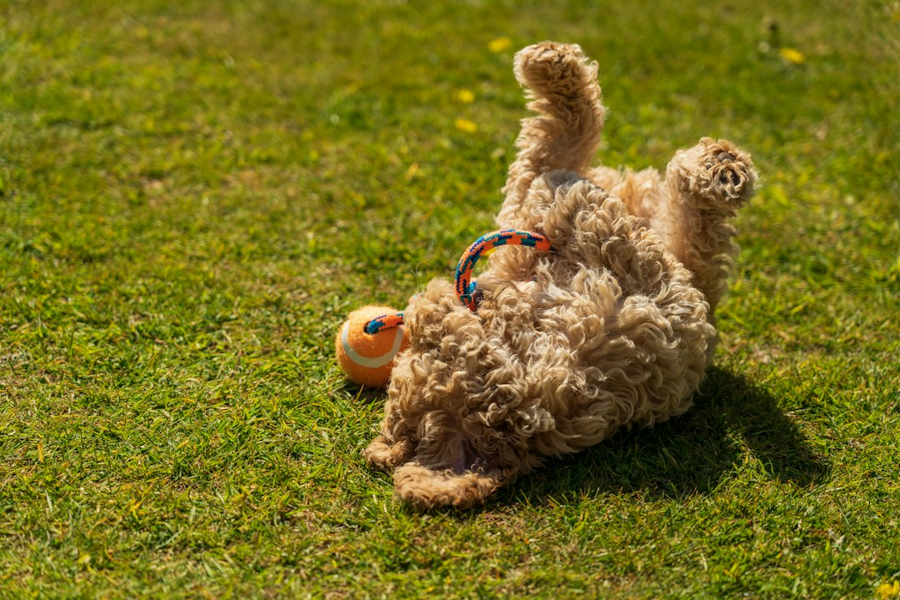

# 宠物总挠痒、掉毛、皮肤发红？皮肤病预防全指南，铲屎官必看！

很多铲屎官都有过这样的困扰：家里毛孩子突然开始频繁抓挠、啃咬自己，翻开毛发一看，皮肤发红、起疹，甚至成片掉毛。宠物皮肤病是兽医门诊中最常见的一类疾病，尤其在潮湿闷热的季节高发。好消息是，绝大多数皮肤问题都可以通过日常护理有效预防。今天我们就来说说，如何让毛孩子远离皮肤病的困扰。

## 一、宠物皮肤病的"四大元凶"

皮肤病不是某一种病，而是一类症状的总称，常见病因主要有四类：

**1. 真菌感染（俗称"癣"）**：由犬小孢子菌等真菌引起，典型表现是圆形脱毛斑、皮屑增多。它属于人畜共患病，人和宠物之间可能互相传染。

**2. 体外寄生虫**：跳蚤、螨虫、蜱虫是罪魁祸首。跳蚤叮咬会引发剧烈瘙痒和过敏性皮炎；螨虫可导致疥螨病、耳螨和蠕形螨病；蜱虫还可能传播血液寄生虫疾病。

**3. 细菌感染**：多为继发性，即皮肤屏障受损后细菌趁虚而入，表现为脓疱、结痂、溃烂，常伴有异味。

**4. 过敏**：包括食物过敏、花粉尘螨等环境过敏和接触性皮炎。过敏通常表现为慢性反复的瘙痒，抓挠又会造成二次感染，形成恶性循环。

<figure style="margin: 1.5em 0; text-align: center;">
  
  <figcaption style="margin-top: 0.5em; color: #666; font-size: 0.9em;">
    宠物皮肤病的常见类型与典型症状
  <small>图片来源: [bao sabrina](https://unsplash.com/@rinako) @ Unsplash</small>
  </figcaption>
</figure>

## 二、哪些情况容易"中招"？

了解诱因，才能精准预防：

- **环境潮湿**：梅雨季、回南天空气湿度大，真菌和细菌繁殖加快；
- **清洁不当**：洗澡过频会破坏皮肤表面的保护性皮脂膜，长期不洗、毛发打结又会藏污纳垢；
- **免疫力低下**：幼年、老年宠物，以及长期生病或营养不良的个体；
- **接触传染源**：与患皮肤病动物接触，或共用梳子、垫子等用品；
- **品种因素**：沙皮犬、斗牛犬等皮肤褶皱多的犬种，褶皱处易积湿积菌；金毛、拉布拉多等品种更易患过敏性皮炎。

## 三、日常预防六步走

**第一步：定期驱虫，雷打不动。** 驱虫是预防寄生虫性皮肤病的基石。一般建议每月一次体外驱虫（滴剂或口服药），具体频率遵医嘱，并常年坚持，不要只在夏天做。

**第二步：科学洗澡，别太"勤快"。** 犬猫皮肤酸碱度和汗腺结构与人类不同，不能使用人的沐浴露。狗狗一般每2至4周洗一次，猫咪视品种和生活环境，几个月一次甚至更久即可。选用宠物专用温和香波，洗后务必彻底吹干，尤其是腋下、腹股沟、脚趾缝等隐蔽部位。

<figure style="margin: 1.5em 0; text-align: center;">
  
  <figcaption style="margin-top: 0.5em; color: #666; font-size: 0.9em;">
    给宠物正确洗澡并彻底吹干毛发
  <small>图片来源: [Hayffield L](https://unsplash.com/@hayffield) @ Unsplash</small>
  </figcaption>
</figure>

**第三步：勤梳毛，多检查。** 每天或隔天梳毛，不仅能去除浮毛、防止打结，更是"皮肤体检"的好机会。梳毛时翻开毛发看一看：有没有红肿、皮屑、结痂、脱毛斑？耳朵里脏不脏？脚底红不红？早发现才能早干预。

**第四步：保持环境干燥清洁。** 定期清洗、暴晒宠物窝垫和玩具，家里勤通风，潮湿季节可使用除湿机。遛狗回家后擦干脚掌和肚皮，雨天尤其注意。多宠家庭若有一只患病，应及时隔离并分开使用用品。

**第五步：吃好睡好，打好免疫底子。** 优质均衡的主粮、足量干净的饮水、充足睡眠和适度运动，是皮肤健康的根本。不建议随意喂食人类食物或劣质零食，避免食物过敏和不必要的添加剂负担。如有慢性过敏，可在医生指导下尝试低敏处方粮或过敏原排查。

**第六步：按时接种疫苗，定期体检。** 疫苗守护整体免疫系统；建议每年至少体检一次，包含皮肤和耳道检查，防患于未然。

<figure style="margin: 1.5em 0; text-align: center;">
  
  <figcaption style="margin-top: 0.5em; color: #666; font-size: 0.9em;">
    兽医为宠物做日常皮肤检查
  <small>图片来源: [Jonatan Bustos](https://unsplash.com/@jonatanbustos25) @ Unsplash</small>
  </figcaption>
</figure>

## 四、发现异常，怎么办？

如果宠物持续抓挠超过一两天，或出现明显脱毛、红斑、结痂，请尽快就医，不要自行用药。人用的药膏（如激素类、某些抗真菌药）对宠物可能无效甚至有毒；盲目使用"偏方"更会延误病情。兽医会通过皮肤刮片镜检、伍德氏灯、真菌培养等手段明确病因，再对症治疗。

<figure style="margin: 1.5em 0; text-align: center;">
  
  <figcaption style="margin-top: 0.5em; color: #666; font-size: 0.9em;">
    兽医通过显微镜检查皮肤刮片样本
  <small>图片来源: [Logan Gutierrez](https://unsplash.com/@photosoflogan) @ Unsplash</small>
  </figcaption>
</figure>

## 写在最后

皮肤病"防大于治"，核心就四个词：**干净、干燥、驱虫、观察**。把这几件事变成日常习惯，毛孩子就能大大减少瘙痒和掉毛的烦恼，你也能少跑几趟医院、少花冤枉钱。

如果宠物已经出现过皮肤问题，可以收藏这份清单，从驱虫频率、洗护用品、居住环境三方面逐项自查。养宠无小事，你多一分细心，它就少一分难受。

<figure style="margin: 1.5em 0; text-align: center;">
  
  <figcaption style="margin-top: 0.5em; color: #666; font-size: 0.9em;">
    健康快乐的狗狗在阳光下玩耍
  <small>图片来源: [Nick Fewings](https://unsplash.com/@jannerboy62) @ Unsplash</small>
  </figcaption>
</figure>
