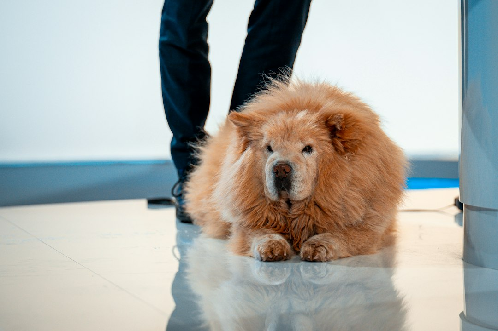
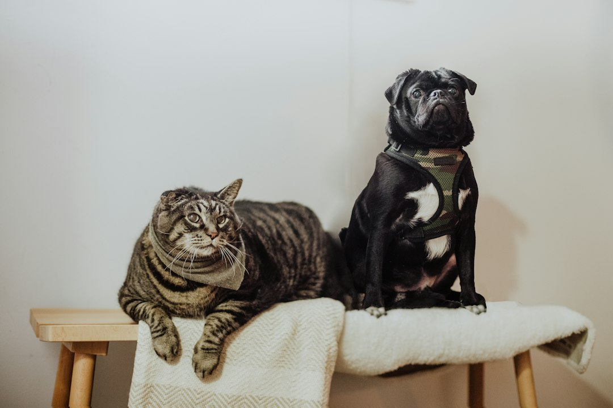
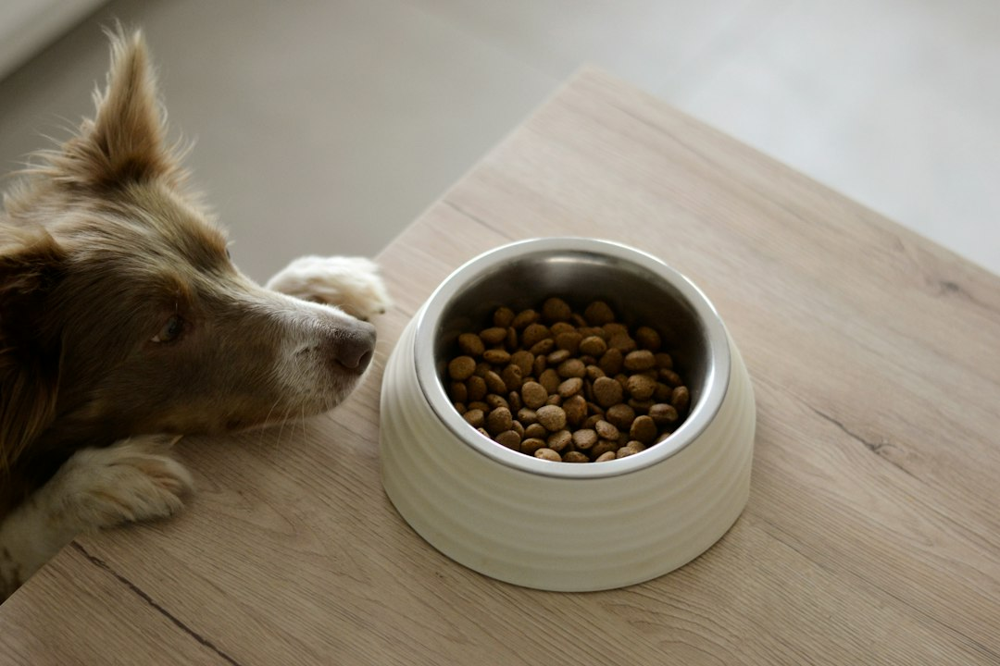
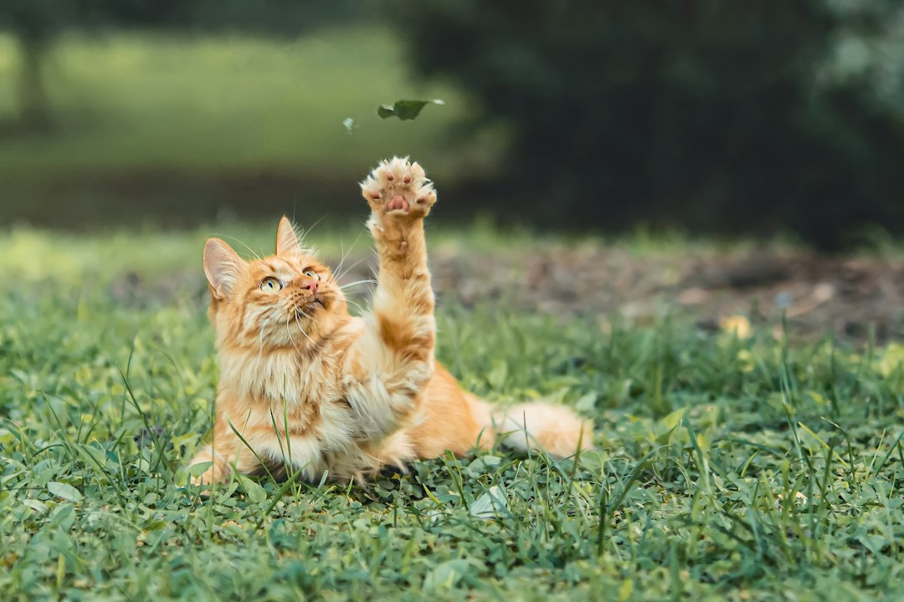

# 别再夸它"胖得可爱"了——宠物体重管理全指南

很多主人把圆滚滚的猫狗当作"养得好"的象征，逢人就说"我家主子胖乎乎的多可爱"。但你可能不知道：全球超过50%的宠物犬猫存在超重或肥胖问题，肥胖已经成为宠物最常见的健康问题之一。今天我们就来聊聊，为什么"胖"不是福气，以及如何科学管理毛孩子的体重。

## 一、肥胖不是"福气"，是一种病

世界小动物兽医协会（WSAVA）已将肥胖明确定义为一种疾病。多余的脂肪并非无害的储备，而是活跃的内分泌器官，会持续释放炎症因子，影响全身健康。

超重宠物的健康风险远超你的想象：

- **关节疾病**：体重每增加一点，膝关节、髋关节承受的压力就成倍增加，骨关节炎风险显著上升
- **糖尿病**：超重是猫咪2型糖尿病最重要的可控危险因素
- **心血管与呼吸问题**：脂肪压迫胸腔和气道，导致运动不耐受、呼吸急促
- **泌尿系统疾病**：肥胖猫更容易发生下泌尿道疾病
- **寿命缩短**：研究显示，终身保持理想体重的犬，平均寿命可延长约2年

<figure style="margin: 1.5em 0; text-align: center;">
  
  <figcaption style="margin-top: 0.5em; color: #666; font-size: 0.9em;">
    兽医为超重宠物进行体检查体
  <small>图片来源: [Jitte Davidson](https://unsplash.com/@jdavidsoncdenv) @ Unsplash</small>
  </figcaption>
</figure>

## 二、怎么判断毛孩子胖不胖？

判断胖瘦不需要复杂的仪器，"看"和"摸"两步就够了，专业上叫体况评分（BCS，9分制）：

- **摸肋骨**：手指轻压就能清晰摸到肋骨，但肉眼看不到——这是理想状态；需要用力按压才能摸到，说明皮下脂肪过多
- **看腰线**：从上方俯视，腰部应有轻微内收；从侧面看，腹部应收起上提
- **参考评分**：9分制中，4~5分为理想体型，7分以上即为肥胖

<figure style="margin: 1.5em 0; text-align: center;">
  
  <figcaption style="margin-top: 0.5em; color: #666; font-size: 0.9em;">
    犬猫体况评分对照图，从过瘦到肥胖一目了然
  <small>图片来源: [Priscilla Du Preez 🇨🇦](https://unsplash.com/@priscilladupreez) @ Unsplash</small>
  </figcaption>
</figure>

## 三、它们是怎么胖起来的？

绝大多数宠物肥胖不是"体质问题"，而是日常习惯累积的结果：

- **凭感觉喂粮**：不按包装建议量，随手一倒就是一大碗，还常常"自由采食"
- **零食当奖励**：人类食物和宠物零食的热量常被忽视。一块奶酪的热量，对小型犬来说可能相当于一餐的三分之一
- **绝育后照旧喂**：绝育后代谢率下降，能量需求降低约20%~30%，食量不变就容易发胖
- **运动不足**：尤其是室内猫，吃饱就睡，活动量趋近于零

## 四、科学减重，这样做才对

**1. 先定目标**：带宠物咨询兽医，确定理想体重，排除甲状腺功能减退等疾病因素，再制定个性化减重计划。

**2. 精确控制食量**：用厨房秤称量每日粮量，按"理想体重"对应的热量喂食，而不是按当前体重。减重期通常喂理想体重维持所需的热量即可。

<figure style="margin: 1.5em 0; text-align: center;">
  
  <figcaption style="margin-top: 0.5em; color: #666; font-size: 0.9em;">
    用厨房秤精确称量宠物每日粮量
  <small>图片来源: [Ayla Verschueren](https://unsplash.com/@moob) @ Unsplash</small>
  </figcaption>
</figure>

**3. 管住零食**：零食热量不超过每日总热量的10%，可用胡萝卜、黄瓜、西蓝花等低热量蔬菜替代。

**4. 增加活动量**：每天规律散步20~30分钟，配合逗猫棒、漏食球、益智玩具，让"吃饭"本身也变成运动。

**5. 定期称重**：每周称重1~2次，目标是每月减重不超过当前体重的2%（猫）~3%（狗）。减重过快有危险，尤其是猫，快速减重可能诱发脂肪肝，危及生命。

<figure style="margin: 1.5em 0; text-align: center;">
  
  <figcaption style="margin-top: 0.5em; color: #666; font-size: 0.9em;">
    主人每天带狗狗规律散步增加活动量
  <small>图片来源: [Age Cymru](https://unsplash.com/@agecymru) @ Unsplash</small>
  </figcaption>
</figure>

## 五、给主人的实用建议

1. **记录食物日记**：把每天的主粮、零食、人类食物统统记下来，你会惊讶地发现热量都从哪里来
2. **全家统一执行**：跟家人约定好，不偷偷投喂，减重计划才有效
3. **保持耐心**：健康的减重以月为单位，别指望一周见效。瘦下来的毛孩子，关节更轻松、精神更充沛，能陪你更久

记住：爱它，不是把它喂胖，而是让它健康地老去。

<figure style="margin: 1.5em 0; text-align: center;">
  
  <figcaption style="margin-top: 0.5em; color: #666; font-size: 0.9em;">
    保持理想体重的猫咪活力充沛地玩耍
  <small>图片来源: [zhang kaiyv](https://unsplash.com/@zhangkaiyv) @ Unsplash</small>
  </figcaption>
</figure>
