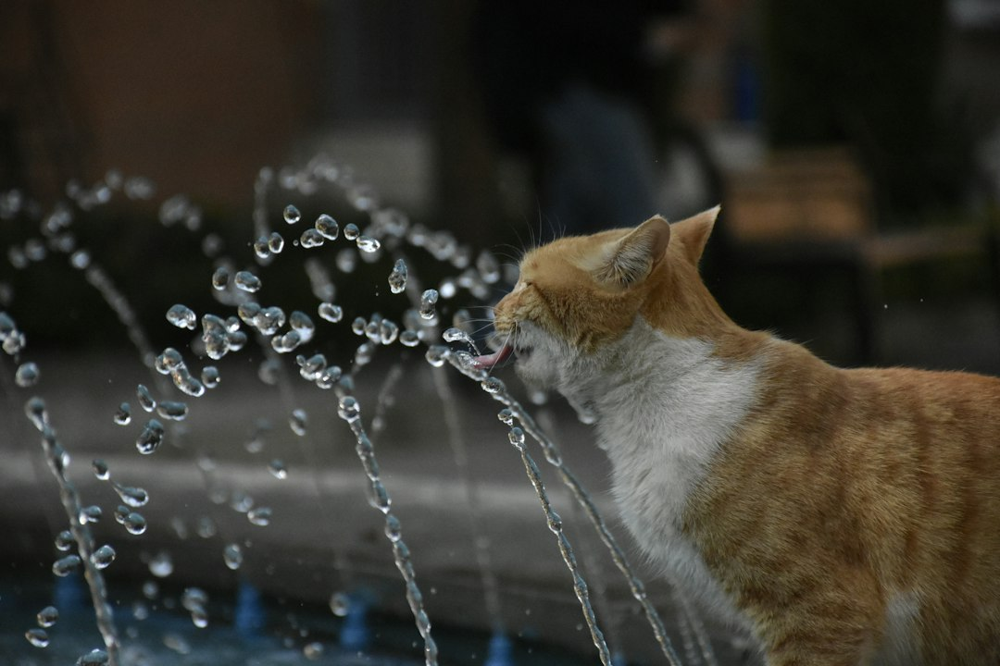
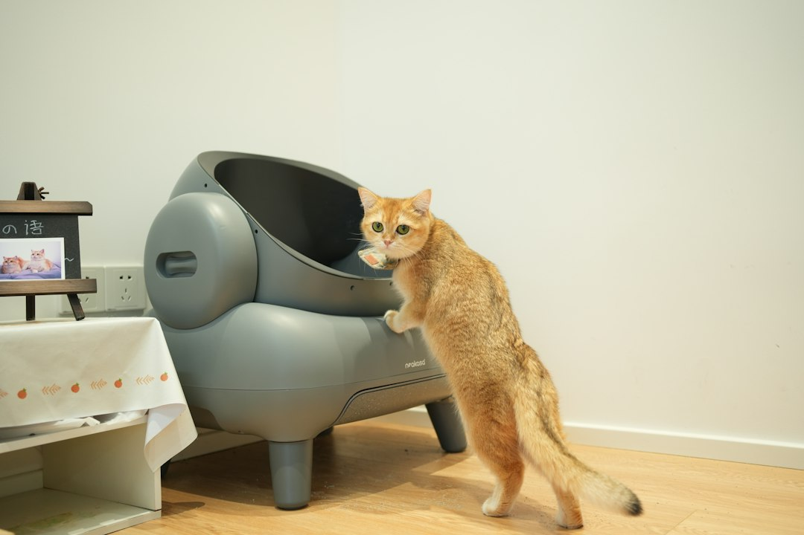
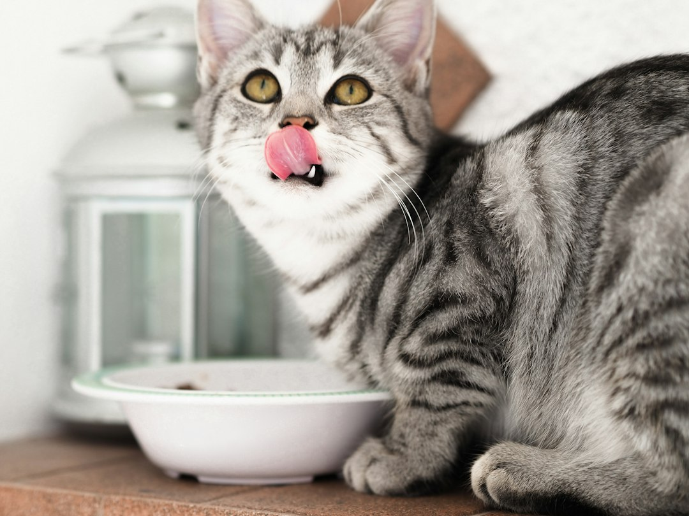
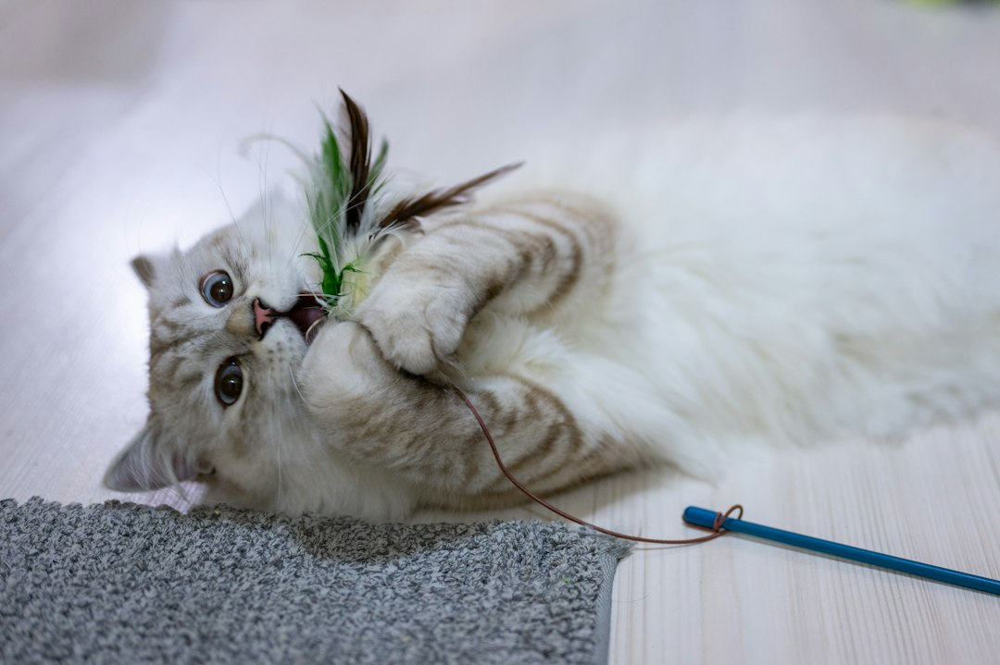

# 猫咪频繁跑猫砂盆却尿不出来？这份泌尿健康指南，越早看越好

猫咪的泌尿系统有多"娇气"，养过猫的人多少都领教过。猫下泌尿道疾病（FLUTD）是宠物医院里最常见的就诊原因之一，轻则反复发作，重则危及生命。今天我们就来把这件事说清楚。

## 一、为什么猫咪的泌尿系统爱出问题？

猫咪的祖先是沙漠地区的野猫，天生口渴感迟钝、不爱喝水，尿液因此高度浓缩。现代家猫长期吃干粮、活动空间小、压力源又多，泌尿系统就成了"重灾区"。在各类下泌尿道疾病中，约半数以上是特发性膀胱炎（FIC），其次是尿结晶、尿结石和尿道堵塞。可以说，不爱喝水是这一切的根源。

<figure style="margin: 1.5em 0; text-align: center;">
  
  <figcaption style="margin-top: 0.5em; color: #666; font-size: 0.9em;">
    猫咪使用流动饮水机喝水，多喝水是预防泌尿疾病的关键
  <small>图片来源: [SMA Fatemi](https://unsplash.com/@3eyedfatemi) @ Unsplash</small>
  </figcaption>
</figure>

## 二、这些信号，说明泌尿系统在报警

猫咪不会说话，但会通过行为告诉你。出现以下任何一种情况，都建议尽快就医：

- 频繁进出猫砂盆，每次却只尿一点点，甚至尿不出来
- 排尿时蹲很久，痛苦嚎叫
- 尿中带血，尿液呈粉红色
- 在猫砂盆以外的地方乱尿
- 不停舔舐尿道口
- 精神变差、躲藏、食欲下降

很多主人以为乱尿是猫咪"闹脾气"，其实它更可能是生病了，在用行为向你求救。

<figure style="margin: 1.5em 0; text-align: center;">
  
  <figcaption style="margin-top: 0.5em; color: #666; font-size: 0.9em;">
    猫咪在猫砂盆中蹲坐排尿困难，是泌尿疾病的典型信号
  <small>图片来源: [Neakasa](https://unsplash.com/@neakasa) @ Unsplash</small>
  </figcaption>
</figure>

## 三、公猫"尿闭"：会要命的急症

最危险的是尿道堵塞，俗称"尿闭"，公猫是高危群体——尿道又细又长，结晶、黏液栓或小结石很容易卡住。完全堵塞后，尿液排不出去，代谢废物在体内堆积，24至48小时内就可能引发急性肾损伤、电解质紊乱甚至心脏骤停。

如果发现猫咪反复蹲猫砂盆却完全没有尿团、腹部胀硬、痛苦不堪，请不要再观察、不要自行喂药，立即送医。这是争分夺秒的急症，拖得越久，抢救难度越大。

## 四、日常预防：把功夫下在平时

好在大部分泌尿问题，都可以通过日常管理降低风险：

1. **多喝水是第一要务。** 提高湿粮比例，使用流动饮水机，家中多放几个水碗，还可以加少量无盐肉汤调味。
2. **控制体重、增加运动。** 肥胖会显著增加泌尿疾病风险，每天用逗猫棒互动15分钟，一举两得。
3. **减少应激。** 猫砂盆数量遵循"猫咪数量+1"原则，放在安静、易到达的位置，每天清理；多猫家庭要保证每只猫都有独立的食盆、水盆和躲藏空间。
4. **定期体检。** 每年至少一次，包括尿检；有过病史的猫咪遵医嘱定期复查。
5. **不乱补保健品。** 泌尿处方粮、酸化剂等应在兽医指导下使用，盲目跟风可能适得其反。

<figure style="margin: 1.5em 0; text-align: center;">
  
  <figcaption style="margin-top: 0.5em; color: #666; font-size: 0.9em;">
    湿粮搭配水碗喂食，能有效提高猫咪日常饮水量
  <small>图片来源: [Laura Chouette](https://unsplash.com/@laurachouette) @ Unsplash</small>
  </figcaption>
</figure>

## 写在最后：给铲屎官的每日"检查清单"

从今天起，每天铲屎时多留个心：今天的尿团和昨天差不多大吗？猫咪进出猫砂盆的频率正常吗？有没有血尿、乱尿或嚎叫？

把这三件事变成习惯，你就能比疾病早一步发现问题。猫砂盆里的变化，就是猫咪泌尿健康最直观的"晴雨表"。多一分留意，少一分风险。

<figure style="margin: 1.5em 0; text-align: center;">
  
  <figcaption style="margin-top: 0.5em; color: #666; font-size: 0.9em;">
    健康活泼的猫咪，日常观察是守护泌尿健康的第一步
  <small>图片来源: [Piotr Musioł](https://unsplash.com/@szamanm) @ Unsplash</small>
  </figcaption>
</figure>
