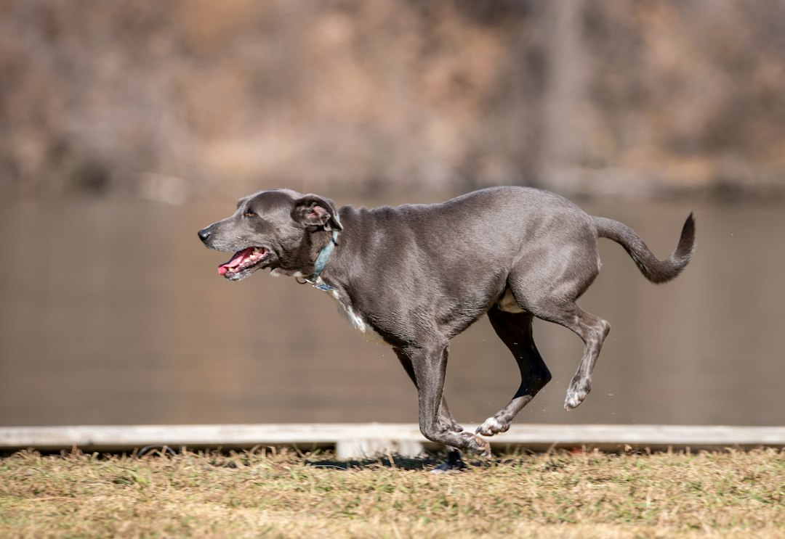
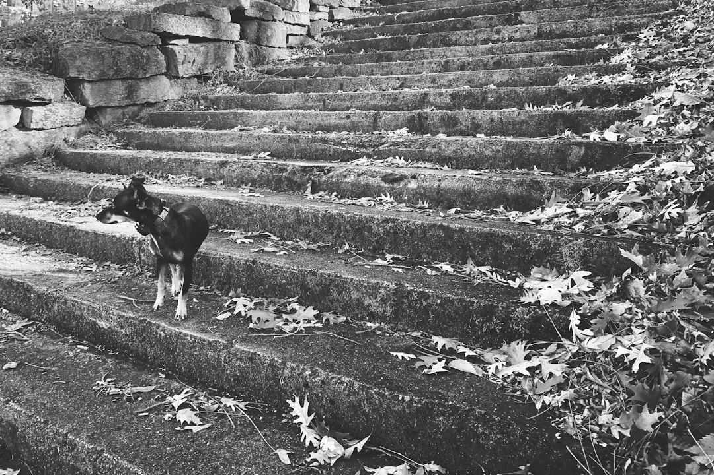
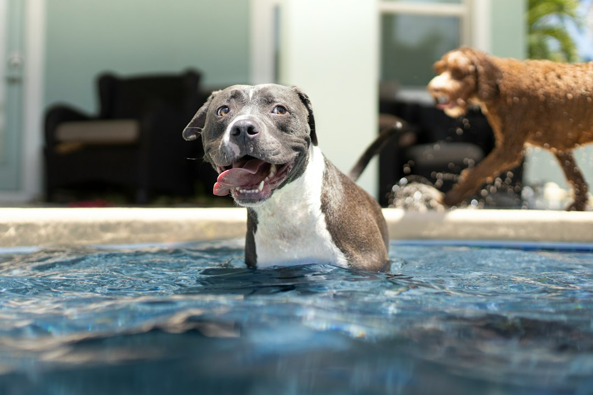
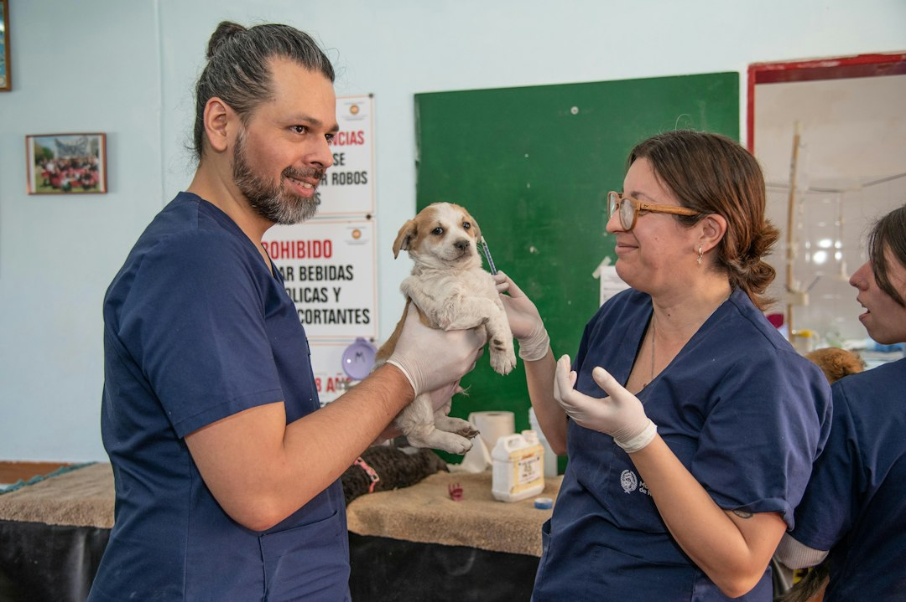

# 别等狗狗走不动才后悔：科学护关节，现在就要开始

你有没有发现，家里的狗狗最近起床时动作变慢了，以前一招呼就飞奔过来，如今却慢悠悠地起身？很多主人以为这只是"年纪大了"的正常现象，却忽略了背后可能隐藏的关节问题。

骨关节炎是犬类最常见的慢性疾病之一。研究数据显示，约有五分之一的成年犬受到关节问题困扰，而8岁以上的老年犬中，这一比例更是高达八成。关节问题不会突然爆发，而是日积月累的结果，往往等到狗狗明显跛行时，软骨磨损已经相当严重。所以，护关节这件事，越早开始越好。

<figure style="margin: 1.5em 0; text-align: center;">
  
  <figcaption style="margin-top: 0.5em; color: #666; font-size: 0.9em;">
    健康的成年犬在户外草地上奔跑，展示正常的活动能力
  <small>图片来源: [Trac Vu](https://unsplash.com/@tracminhvu) @ Unsplash</small>
  </figcaption>
</figure>

## 哪些狗狗是关节问题的高风险群体？

虽然任何狗狗都可能出现关节问题，但以下几类尤其需要主人多加留意：

**大型犬和特定品种**：金毛、拉布拉多、德牧、柯基、柴犬等品种，天生更容易发生髋关节发育不良或髌骨脱位，这是许多关节病变的起点。

**肥胖犬**：体重超标是关节的"头号杀手"。狗狗每多1公斤体重，四肢关节承受的压力都会成倍增加，软骨磨损速度也随之加快。

**老年犬**：和人类一样，随着年龄增长，狗狗关节液减少、软骨弹性下降，退行性变化难以避免。

**有过关节损伤的犬**：曾经骨折、韧带撕裂或长期从事高强度运动的狗狗，受伤的关节往往更早出现退化。

<figure style="margin: 1.5em 0; text-align: center;">
  
  <figcaption style="margin-top: 0.5em; color: #666; font-size: 0.9em;">
    肥胖的狗狗趴在沙发上，体重超标会增加关节负担
  <small>图片来源: [Alexis Antoine](https://unsplash.com/@hey_alex) @ Unsplash</small>
  </figcaption>
</figure>

## 捕捉狗狗发出的"求救信号"

关节疼痛的早期表现往往很隐蔽，主人可以通过以下细节来判断：

1. **起身变慢、动作僵硬**：睡醒或久卧后起身困难，走几步后才慢慢放松；
2. **活动意愿下降**：不再主动跳上沙发、拒绝爬楼梯、遛弯时频繁停下；
3. **步态改变**：轻微跛行、"兔子跳"式上楼梯，或走路时后腿不敢完全着地；
4. **情绪和行为变化**：频繁舔舐某个关节、触摸时躲闪或低吼、变得不爱互动。

如果发现以上任何一种信号，建议尽快带狗狗就医检查，而不是自行判断"忍忍就过去了"。早期干预能显著延缓病情发展。

<figure style="margin: 1.5em 0; text-align: center;">
  
  <figcaption style="margin-top: 0.5em; color: #666; font-size: 0.9em;">
    狗狗上楼梯时出现犹豫和跳跃动作，可能是关节不适的信号
  <small>图片来源: [Gary Meulemans](https://unsplash.com/@anakin1814) @ Unsplash</small>
  </figcaption>
</figure>

## 日常护关节，做好这四件事

**第一，管住体重。** 这是性价比最高、效果最确切的护关节手段。给狗狗制定科学的喂食计划，避免零食过量，必要时选择低热量处方粮。理想状态下，从上方俯视狗狗应能看到明显的"腰线"。

**第二，科学运动。** 适度运动能增强关节周围的肌肉力量，为关节提供支撑。推荐游泳、慢速散步等低冲击运动；要避免突然的剧烈奔跑、急停急转和高空跳跃。老年犬建议"少量多次"，每次15~20分钟。

**第三，合理补充营养。** 目前有研究支持的关节营养补充剂包括：葡萄糖胺和硫酸软骨素（为软骨修复提供原料）、Omega-3脂肪酸（EPA/DHA具有抗炎作用）、绿唇贻贝提取物等。需要提醒的是，补充剂不能替代药物，严重关节炎仍需在兽医指导下规范治疗。

**第四，改造居家环境。** 在光滑地板上铺防滑垫，给爱跳上沙发的狗狗准备宠物台阶，为老年犬提供柔软的保暖垫，冬天注意关节保暖——这些看似微小的改变，都能实实在在地减轻关节负担。

<figure style="margin: 1.5em 0; text-align: center;">
  
  <figcaption style="margin-top: 0.5em; color: #666; font-size: 0.9em;">
    狗狗在水池中游泳进行低冲击运动，游泳是护关节的理想运动
  <small>图片来源: [Anthony Duran](https://unsplash.com/@dogflirt) @ Unsplash</small>
  </figcaption>
</figure>

## 写在最后

关节的损伤不可逆，我们能做的是：早发现、早干预、延缓进程。建议主人们做到"三个定期"——定期给狗狗称体重，定期观察它的步态和起身动作，老年犬每年体检时增加关节触诊和影像学检查。今天的每一次留意，都是狗狗未来多奔跑一天的底气。护关节没有捷径，靠的是主人日复一日的细心。

<figure style="margin: 1.5em 0; text-align: center;">
  
  <figcaption style="margin-top: 0.5em; color: #666; font-size: 0.9em;">
    兽医为狗狗进行关节触诊检查
  <small>图片来源: [Jonatan Bustos](https://unsplash.com/@jonatanbustos25) @ Unsplash</small>
  </figcaption>
</figure>
